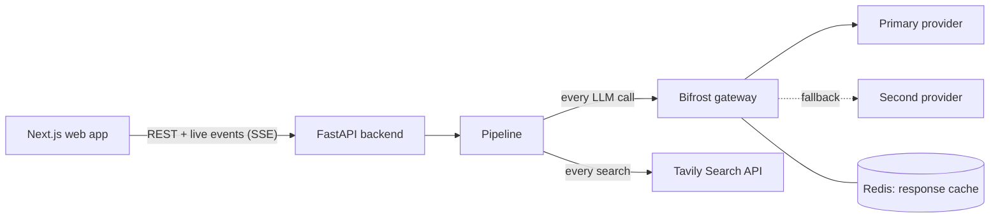

# ShelfLife

**Find the claims in an AI answer that have gone out of date.**

Language models answer from training data with a cutoff, and they state old prices, versions, office holders and laws with full confidence. ShelfLife takes an AI-generated answer and finds the claims that can change over time. It re-checks them against live web sources with Tavily, and gives each one a freshness score. The score is calculated in code from the evidence, so every number can be explained. ShelfLife then writes a corrected answer that changes only the stale claims and cites the sources. Every LLM call goes through the Bifrost gateway, which provides model tiering, automatic fallbacks, response caching and a budget.

Built for the Geek Room Global AI Hackathon 2026, problem statement 06 (Tavily).

## What it does

| Requirement | How ShelfLife meets it |
|---|---|
| Claim identification | A fast model splits the answer into self-contained claims, each tagged with a category and its position in the text. Code checks every position against the answer. |
| Freshness detection | Each category changes at its own rate, from 30 days for current events to 540 days for laws. History, definitions and science are marked as not time-sensitive and skipped. |
| Live verification | Tavily searches for each time-sensitive claim. A stronger model records whether each source supports or contradicts the claim, and backs each stance with a quote that code checks is really in the source. |
| Freshness scoring | Code combines each source's authority, age and stance into a 0–100 score and a verdict: fresh, uncertain, stale or unverified. The full breakdown is shown for every claim. |

The web app highlights each claim in the answer as it's scored. It shows "Answer said" next to "Sources now say", with dates, quotes and links. A **Corrected answer** tab shows the changes as a diff, and the whole report downloads as Markdown or JSON.

**Try it without keys:** set `DEMO_MODE=true` in `.env` and every page runs on a built-in simulator with invented companies and prices. The web app then starts an automatic guided walkthrough that drives every feature and explains each one beside it on screen; replay it from the corner button. [docs/testing.md](docs/testing.md) lists what to try and what you should see.

## The app

| Page | What it's for |
|---|---|
| **Check** | Check one answer, optionally for a reader's country, plan or environment. Tabs show the checked answer, the corrected answer, how claims depend on each other, and whether the sources still exist. |
| **Compare** | Paste answers from 2–5 AI apps to the same question. Each fact is searched once and every app's version is judged against the same sources. |
| **Dashboard** | Totals, checks per day, verdicts by kind of fact, answers held back, claims due for a re-check, saved contexts that changed, and Bifrost and Tavily usage. |
| **Claims** | Every claim ever checked, each with a verification passport: when it was first and last checked, by which sources, and its verdict history. |
| **Monitors** | Regression tests that re-ask a model a question, a link checker, batch checks from pasted text or CSV, and context profiles. |
| **Evaluation** | Precision, recall and false alarms on the human-labelled dataset, once it has run. |
| **Impact** | Every stale claim traced to the claims, answers and documents built on it; registered documents with corrected versions and revision history. |
| **Graph** | The dependency freshness graph across all answers and documents: load-bearing claims, blast radius, declared dependencies. |
| **Policies** | Freshness policy presets and your own: half-lives, re-check intervals and guard rules per kind of fact. |
| **Autopilot** | Switch between manual and auto mode, run a cycle, and follow the agent's activity log. The same switch is in the header. |
| **System** | Bifrost, virtual key, budget, cache plugin and Tavily status; integrations (MCP, answer guard, webhook); the bookmarklet; the API. |

## Beyond the brief

A fact-checker asks whether a statement is true. ShelfLife also asks whether it is still true, what changed, and when to check again.

- **What changed.** A stale claim shows the old value next to the new one, with the kind of change: a new price, a newer version replacing an old one, a product discontinued or renamed. The old value must appear in the claim itself, and the new one must be backed by a quoted source.
- **Re-check dates.** Every fresh or uncertain claim gets the date its newest evidence will be too old to keep its verdict, worked out in code from how fast that kind of fact changes. The whole answer gets the earliest of those dates.
- **Independent sources.** Three sites repeating one press release are one confirmation, not three. Pages from the same owner, or near-identical text on different sites, count once in the score, and the claim card says how many sources were independent.
- **Full pages for thin snippets.** When the entity's own pricing, version or product page returns a thin search snippet, ShelfLife reads the page with Tavily Extract, asking only for the passages relevant to the claim.
- **Check history.** Every finished check is saved. Re-checking an answer shows each claim's verdict over time, and the home page lists claims whose re-check date has passed or is coming up.
- **Affected earlier answers.** When a claim is found stale, ShelfLife lists earlier answers that stated the same fact and were trusted at the time, so they can be reviewed.
- **One-call API.** `POST /api/verify` checks an answer and returns the full result in a single request, so any AI app can add a freshness check before showing an answer.

### Checking what an answer builds on facts

Answers don't only state facts. They calculate with them, assume things, and recommend. ShelfLife follows those links.

- **Hidden assumptions.** The extractor also lists up to three things the answer takes for granted without saying, such as "the plan allows 10 seats", and checks them like any other claim.
- **Numbers recalculated.** A figure computed from other claims ("10 seats cost $200") is stored as a formula. Code recomputes it with today's values, so a stale price makes its total stale too, with the new result.
- **Recommendations re-judged.** Advice built on claims ("Nimbus is cheapest") is re-checked when anything under it changes. A model decides whether it still holds, using only the checked facts, and may only use numbers those facts contain.
- **Dependency graph.** The **Dependencies** tab shows which claims each recommendation and calculation rests on, with their verdicts.
- **API and code changes.** Claims about function calls, SDK versions and endpoints are checked against changelogs and documentation, and flagged as deprecated or replaced.
- **Availability and context.** For a chosen country, plan, currency or software environment, local claims are searched with Tavily's country setting and judged for that reader. Availability claims ("available in India") are their own kind.
- **Answer guard.** Each check ends with advice for the app showing the answer: show it, show it with a warning, or hold it back. A stale recommendation, or half the claims stale, means hold it back.

### Claims read in context, corrections that stay consistent

Answers describe values as they state them: "the latest release is version 3.13, launched on October 7, 2024". Split into claims, the date reads "3.13 was launched on October 7, 2024", which is true forever. But once the version is corrected to 3.15, the date beside it describes 3.15, and is wrong.

- **Coupled details are re-checked for the new value.** A claim that shares a stale claim's passage, or refers back to it, is restated about the current value ("3.15 was launched on October 7, 2024"), searched and judged like any other claim. Its verdict, evidence and new value are shown with a note saying what it was checked as.
- **One edit per passage.** Overlapping claims are rewritten together, so the version and its date change in one consistent replacement, each with its own source. The replacement must state every current value, and a detail that couldn't be confirmed for the new value must be removed rather than left describing the wrong thing.
- **Every claim is judged on its own timeline.** The extractor reads the question and the whole answer to decide whether each claim describes now, a past time, or a plan. "In June 2025 the latest release was 4.2" (or "Jack Dorsey is the CEO" in answer to "Who was CEO in 2020?") is checked as of that time: sources from before it lose weight, sources written later can report it, a later change never contradicts it, and it never needs re-checking. It is shown as correct or wrong *for its time*, and a wrong one is corrected with the value at that time. A planned or expected claim is checked against what happened or what is planned now.
- **Claims are judged in their passage.** The judge sees the question and the sentences around each claim, so it reads the claim the way the answer meant it.
- **Lists of the current state are time-sensitive.** "3.0 through 3.8 are no longer supported" is checked as a complete current list, so a newer end-of-life version makes it stale.

### Downstream impact, dependencies and policies

- **Downstream impact analyzer.** Register the documents an app builds from AI answers (proposals, projections, emails, reports), through the **Impact** page, `POST /api/documents` or the MCP tool. Their claims are found and linked to claim passports, by id when the app declares which claims it used and by meaning otherwise. When a claim goes stale, the impact report lists every dependent claim, answer and document with the path that links them, and each affected document gets a corrected version: values replaced, totals recalculated in code, advice re-judged, with sources. Corrections can be applied by hand or by Autopilot, and every revision is kept.
- **Dependency freshness graph.** Claims that rely on other claims are tracked within answers (a total relies on a price; a release date describes a version) and across them: apps declare links such as "this library recommendation relies on this Python version, which relies on this OS release". The **Graph** page shows load-bearing claims and lights up a claim's blast radius.
- **Personalised freshness.** A freshness policy sets, per kind of fact, the half-life used to score evidence age, a fixed re-check interval, and which stale categories hold an answer back. Presets cover developer assistants, production APIs, business intelligence and research; apps can save their own, choose a default, or pass `policy_id` per check.

### Manual or autonomous

In **manual** mode ShelfLife works when asked. In **auto** mode the Autopilot agent runs a cycle on a timer and takes every step itself: it re-verifies answers whose claims are due (by evidence age or the policy's interval) or whose context profile changed, revisits the sources each answer relied on and re-checks answers whose evidence moved or vanished, verifies documents that state unchecked claims, traces every newly stale claim downstream and corrects the documents built on it, and runs regression tests. Each cycle has a check budget, every action goes to an activity log, and impact alerts go to the webhook.

### Ways to plug it in

- **MCP server.** `POST /mcp` (streamable HTTP) and `uv run python -m app.mcp_stdio` expose `verify_answer`, `impact_of_claim`, `stale_claims`, `register_document`, `link_claims`, `get_claim`, `watchlist`, `autopilot` and `list_policies`, so any MCP-capable agent can check its own answer before replying.
- **Answer guard.** `POST /api/verify` returns the advice and a corrected answer in one call.
- **Autonomous agent.** Autopilot, above.
- **Webhook, bookmarklet, CLI.** As below.

### Keeping answers fresh over time

- **Compare AI apps.** Different assistants often give different numbers for the same fact. **Compare** lines them up and shows which app is current.
- **Verification passports.** Each claim gets a stable ID (`CLM-…`) and a record of every check, so an app can see when a fact was last confirmed.
- **Regression tests.** Save a question, a model and words the answer must contain. Each run asks the model through Bifrost and checks its answer, so you see when a model starts giving outdated answers.
- **Context profiles.** Save who answers are for. When a profile changes, checks made for the old version are flagged on the dashboard.
- **Link rot.** Re-visit the sources a check relied on and the links in the answer, and flag pages that moved, were deleted, or no longer contain the quoted evidence.
- **Batch checks.** Check up to 20 answers from pasted text or a CSV file.
- **Webhook alerts.** Set `ALERT_WEBHOOK_URL` and every check that finds stale claims posts them, with the corrected answer, to another system.
- **Bookmarklet.** Select an answer on any website and send it to ShelfLife in one click.

## How it works



Each check runs these stages:

1. **Extract** (fast model): split the answer into claims with categories, kinds, search queries and positions, plus hidden assumptions, formulas and dependencies.
2. **Triage** (code): skip claims that can't go out of date, set aside calculations and recommendations, and cap the number of claims, keeping the fastest-changing first.
3. **Retrieve** (Tavily): search for each claim, several at a time, with the reader's country where it matters, and drop duplicate URLs.
4. **Adjudicate** (strong model): record each source's stance, with a quote and the current value.
5. **Score** (code): calculate the freshness score from authority, recency and agreement, with the half-lives of the chosen freshness policy.
6. **Couple** (fast model and steps 3–5): restate each detail of a now-stale value about the current value, and check it.
7. **Resolve** (code and strong model): recompute calculations with current values, re-judge recommendations whose facts changed, and decide the advice for apps.
8. **Rewrite** (strong model and code): replace only the stale passages, overlapping claims together, and flag claims that couldn't be verified.

The web app receives an event after each stage and after each claim, so the answer fills in live. If the browser disconnects, the check keeps running and the browser can resume from the last event it saw.

## How Tavily contributes

Tavily is the source of every fact ShelfLife treats as current. The pipeline never uses a model's memory for current values.

- **Search by category.** Claims about leadership, products and current events use Tavily's `news` topic. Pricing, versions, statistics and laws use `general`.
- **Dated results.** Every search asks for `include_published_date`, because recency is half of the score. Tavily's date is its best estimate of when the page was published or updated.
- **Country.** For local claims (prices, availability, laws, events) with a chosen country, the query names the country and Tavily's `country` parameter boosts results from it.
- **Official sources first.** For pricing and version claims, the entity's own domain goes in `include_domains` with `include_domains_mode: "prefer"`. Official pages rank higher, and other pages still appear.
- **Deep verify.** A switch in the web app moves from `basic` to `advanced` search depth, which costs two credits per search instead of one.
- **Search, then extract.** For thin snippets from the entity's own site, ShelfLife calls Tavily Extract with the claim's query, so Tavily returns the most relevant passages of the full page rather than the whole page. Up to two pages are read per claim.
- **Credits and caching.** Each check counts the Tavily credits it used. Results are cached on disk for at most six hours, so re-runs during development and the demo are free without the cache making answers stale.
- **Health and icons.** The health check calls Tavily's usage endpoint instead of running a search. Source favicons come from Tavily too, so the web app needs no third-party icon service.

## How Bifrost contributes

Every LLM call goes through Bifrost, and the web app shows what it did for each one.

| Feature | How ShelfLife uses it | Where you see it |
|---|---|---|
| Model tiering | `MODEL_FAST` extracts claims. `MODEL_STRONG` judges evidence, re-judges recommendations and writes the corrected answer. `MODEL_STALE` writes answers from memory; regression tests can ask any model Bifrost serves. | The metrics panel splits calls, tokens and time by stage. |
| Fallbacks | Every call sends a fallback list on another provider. ShelfLife records Bifrost's routing information for each call. | Each claim shows which model judged it and marks fallbacks. The metrics panel lists fallbacks. |
| Response cache | Each stage has its own cache key, and entries last at most 24 hours. The check stages match exactly, and the adjudication prompt includes a hash of its evidence, so a cached verdict can never come from different evidence. Only the demo answer generator matches by meaning. | **Run again** compares cost, time and cache hits with the previous run. |
| Budget | The app uses one virtual key with a dollar budget. Bifrost blocks calls once it runs out, and ShelfLife shows a clear message. | The metrics panel shows the key's spend against its budget. |
| Governance errors | Bifrost's error types for a missing, unknown or blocked key, or a blocked model, become messages that say what to fix. | The health check and error messages. |
| Logs | Every call appears in Bifrost's request logs. | The Bifrost dashboard. |
| Admin API | ShelfLife reads the cache plugin's state and can turn it on, using `BIFROST_SETUP_TOKEN`. | The **System** page. |

## The freshness score

For each source that supports or contradicts a claim:

- **Authority** `a`: 1.0 for the entity's own site or a government site, 0.8 for major news agencies, 0.7 for tech and trade press, 0.6 for Wikipedia, 0.4 for unknown sites and 0.2 for forums and social media.
- **Recency** `r = 0.5 ^ (age in days / half-life)`. A source with no date gets 0.7 if it's official and 0.35 otherwise.
- **Weight** `w = a × r`.

With `S` the total weight of supporting sources and `C` the total weight of contradicting ones:

```
if S + C < 0.15:  no score, verdict "unverified"
score = round(100 × S / (S + C) × (0.5 + 0.5 × recency of the newest supporting source))
```

Sources that aren't independent, because they share an owner or repeat the same story, count once for each stance: only the heaviest of them adds weight.

A score of 70 or more is **fresh**, 40–69 is **uncertain**, and below 40 is **stale**. A claim supported only by old sources lands in uncertain rather than fresh. A recent official contradiction makes a claim stale, even if old blogs still agree with it.

| Category | Half-life |
|---|---|
| Current events | 30 days |
| Pricing | 90 days |
| Versions and APIs, product status | 120 days |
| Statistics | 180 days |
| Leadership | 365 days |
| Laws and regulations | 540 days |

### Why a claim can score 0/100

The score measures how much current evidence agrees with the claim, not how sure ShelfLife is. When every counted source contradicts a claim, agreement is 0 and so is the score. That's a confident "out of date", not a failure. The claim card shows a separate **Evidence strength** (`1 − e^(−(S + C) / 0.8)`, as a percentage), so a 0 backed by strong evidence reads differently from a weak one. A check that finds nothing usable gives "unverified" with no score.

The re-check date is the first day the verdict would change if no new evidence appeared, found by re-running the same formula on future dates.

The constants live in `backend/app/config.py`. `scripts/eval_tune.py` tests other values against the labelled dataset.

## Evaluation results

<!-- eval-results:start -->
No results yet. The dataset needs human labels first: see [Evaluation](#evaluation) below. `run_eval.py --update-readme` writes the numbers here.
<!-- eval-results:end -->

## Quick start

You need Python 3.11+ with [uv](https://docs.astral.sh/uv/), Node.js 20+, a Tavily API key, and API keys for two LLM providers. On Windows, use `copy` instead of `cp`.

```bash
cp .env.example .env
docker compose up -d
cd backend && uv sync && uv run uvicorn app.main:app --port 8000
cd frontend && npm install && npm run dev
cd backend && uv run python ../scripts/bifrost_setup.py --enable-cache
```

To try it without any keys first, put only `DEMO_MODE=true` in `.env`, skip Docker and the setup below, and start the backend and web app.

Run each command from the project root, and the backend and web app in separate terminals. `docker compose` starts Bifrost on port 8080 and Redis on 6379. Without Docker, run `npx -y @maximhq/bifrost -app-dir ./bifrost` for Bifrost; see [Turning on the cache](#turning-on-the-cache) for Redis.

Before the last command, set up Bifrost once:

1. In `.env`, set `TAVILY_API_KEY` and a long random `BIFROST_SETUP_TOKEN`.
2. Open http://localhost:8080 and add keys for both providers.
3. Under **Virtual Keys**, create a key for ShelfLife. Allow both providers and the models you'll use, and give it a budget, such as $5 a month. Bifrost rejects LLM calls without a virtual key by default. Put the key in `BIFROST_VK`.
4. Set `MODEL_FAST`, `MODEL_STRONG`, `MODEL_STALE` and the `FALLBACKS_*` lists in `.env`, using `provider/model` names. Put a model from the second provider in each fallback list.

`bifrost_setup.py` then reports anything missing. Open http://localhost:3000 to use the app. http://localhost:8000/api/health checks that Bifrost, the virtual key and Tavily all work.

If the API isn't at `http://localhost:8000`, set `NEXT_PUBLIC_API_URL` in `frontend/.env.local`. If the web app runs on another address, add it to `CORS_ORIGINS` in `.env`.

### Turning on the cache

Bifrost's cache needs a vector store. Add this to `config.json` in Bifrost's app folder (`bifrost/` with Docker or `-app-dir ./bifrost`), restart Bifrost, then run `bifrost_setup.py --enable-cache`:

```json
"vector_store": {"enabled": true, "type": "redis", "config": {"addr": "redis:6379"}}
```

Use `redis:6379` with Docker Compose, where Bifrost reaches Redis by its service name, and `localhost:6379` when Bifrost runs with `npx`.

Without Docker, use Redis 8 in WSL or Redis Cloud's free plan. Redis needs the search commands, which Ubuntu's default `redis-server` package lacks. Everything else works without the cache.

## Using ShelfLife

**Web app.** Paste an answer, or pick an example question to get an answer from `MODEL_STALE`, then click **Check freshness**. Click any highlighted claim to see its evidence and score breakdown. The other pages are described in [The app](#the-app), and [docs/testing.md](docs/testing.md) walks through every feature.

**Command line.**

```bash
cd backend
uv run python -m app.cli "Paste the AI answer here"
```

Add `--question "..."`, `--answer-date YYYY-MM-DD`, `--deep`, `--json` or `--markdown` as needed. Use `--file answer.txt` for longer answers.

**API.**

| Endpoint | Purpose |
|---|---|
| `POST /api/checks` | Start a check with `{answer, question?, answer_date?, deep?, use_cache?, context?, profile_id?}`. `context` is `{country?, edition?, environment?, currency?}`. Returns `202` and `{check_id}`. |
| `GET /api/checks/{id}/events` | Server-sent events: `claims_extracted`, `claim_evidence`, `claim_scored`, `metrics`, `rewrite_ready`, `done` or `error`. Supports `Last-Event-ID`. |
| `POST /api/verify` | Check an answer in one call and return the full result when it's done. |
| `GET /api/checks/{id}` | The final result. Returns `202` while running and `500` if the check failed. Finished checks are also loaded from history. |
| `GET /api/checks/{id}/history` | Each claim's verdict across every check of the same answer. |
| `GET /api/checks/{id}/affected` | Earlier answers that stated a fact this check found stale. |
| `GET /api/watchlist?days=7` | Claims whose re-check date has passed or falls within the next few days. |
| `GET /api/checks/{id}/export?format=md\|json` | Download a finished check as a Markdown report or JSON. |
| `POST /api/generate-stale` | Get a from-memory answer to `{question}` from `MODEL_STALE`. |
| `GET /api/budget` | The virtual key's budget and spend, from Bifrost. |
| `GET /api/health` | Check that Bifrost, the virtual key and Tavily work. |
| `POST /api/compare` | Compare `{question?, answers: [{app, answer}], context?}` from 2–5 apps. `GET /api/comparisons` lists earlier ones. |
| `GET /api/claims?status=&q=` | The claim registry. `GET /api/claims/{id}` returns one claim's passport and history. |
| `GET /api/dashboard` | Totals, charts, watchlist, context changes, held-back answers and usage. `GET /api/checks` lists recent checks. |
| `GET, POST /api/tests` | Regression tests `{name, question, model?, must_include}`. `POST /api/tests/{id}/run` runs one; `GET /api/tests/{id}/runs` lists runs; `DELETE /api/tests/{id}` removes it. |
| `GET, POST /api/profiles` | Context profiles `{name, context}`, with `PUT` and `DELETE /api/profiles/{id}`. The list includes checks made for an older version. |
| `POST /api/links/check` | Check `{check_id?, urls?}`: the sources a check used and any links given. |
| `POST /api/batch` | Check up to 20 `{items: [{question?, answer}], context?}`. Returns `{batch_id}`; poll `GET /api/batch/{id}`. |
| `GET /api/system` | Service status, settings and the cache plugin. `POST /api/system/enable-cache` turns the cache on. |
| `GET /api/evaluation` | The latest evaluation results, if any. |
| `GET, POST /api/policies` | Freshness policies, with `PUT` and `DELETE /api/policies/{id}`; `PUT /api/policies-default` sets the default. Checks accept `policy_id`. |
| `GET, POST /api/documents` | Documents built from claims `{title, kind, text, check_id?, passport_ids?}`, each with its linked claims, status and corrected version. `POST /api/documents/{id}/apply` applies the correction. |
| `GET /api/impact` | Every stale claim with its downstream impact. `GET /api/impact/{passport_id}` reports one. |
| `GET /api/graph` | The dependency freshness graph. `GET, POST /api/graph/edges` and `DELETE /api/graph/edges/{id}` manage declared dependencies `{upstream, downstream, note}`. |
| `GET, PUT /api/autopilot` | Autopilot mode (`manual` or `auto`), interval, per-cycle check budget, pending work and activity. `POST /api/autopilot/run` runs one cycle now. |
| `POST /mcp` | The MCP endpoint (JSON-RPC: `initialize`, `tools/list`, `tools/call`). |

## Demo

[docs/demo.md](docs/demo.md) has the three-minute run-sheet and a checklist for the night before. [docs/testing.md](docs/testing.md) is the feature-by-feature test guide, and `scripts/feature_tour.py` runs every feature through the API. `scripts/failover_demo.py` runs the Bifrost part from the terminal: a first check, a cached re-run, then a run with the cache off while the primary provider is disabled.

## Evaluation

The evaluation measures stale detection on answers that a person has labelled against real sources. Claude Code drafted the questions and tools, but every gold label and current value comes from a person checking a source. Run these from `backend/`:

1. `uv run python ../scripts/eval_build.py` asks `MODEL_STALE` to answer the 40 questions in `data/eval/questions.jsonl`, and drafts each answer's claims without labels.
2. `uv run python ../scripts/eval_label.py --labeller "Your Name"` walks through each claim. Mark it stale, fresh or static, with a source URL and, for stale claims, the current value. Add any claims the extractor missed, or extraction recall will look better than it is.
3. `uv run python ../scripts/run_eval.py --second-run --update-readme` runs the pipeline on every labelled answer. It writes `eval/results.md` and `eval/results.json`, and updates the numbers in this README.
4. `uv run python ../scripts/eval_tune.py` re-scores the saved evidence with other constants, without new API calls.

Labels go out of date too. The night before judging, re-check them with `eval_label.py --recheck-older-than 1` and run the evaluation again.

## Safeguards

- **No evidence, no verdict.** A claim needs relevant, recent-enough sources to get a score. Otherwise it's "unverified".
- **Quotes are checked.** A stance only counts if its quote really appears in the source.
- **Web text is data.** Search snippets go into prompts inside delimiters that page content can't close, and the model is told to ignore instructions in them.
- **Arithmetic in code.** Dates, ages, weights and scores are all calculated in Python, never by a model.
- **Corrections can't invent numbers.** A rewrite that adds a number not in the current value is rejected in favour of a plain "(now ...)" note.

## Project layout

```
backend/app/          FastAPI app, pipeline stages, Bifrost and Tavily clients, evaluation tools
backend/app/demo/     Demo mode: a simulator of Bifrost, Tavily and the web with invented data
backend/tests/        Unit and end-to-end tests with simulated services; live tests with -m live
frontend/             Next.js web app
scripts/              Bifrost setup check, failover demo, feature tour, webhook receiver, evaluation tools
data/eval/            Evaluation questions and the labelled dataset
eval/                 Evaluation results
docs/demo.md          Demo run-sheet
docs/testing.md       How to test every feature
docker-compose.yml    Bifrost and Redis
```

## Tests

```bash
cd backend && uv run pytest
cd frontend && npm run lint && npm test && npm run build
```

`uv run pytest -m live` also calls the real Bifrost and Tavily services and spends a few credits.

With the backend running, `uv run python ../scripts/feature_tour.py` (from `backend/`) runs every feature through the API and prints pass or fail for each. In demo mode it checks exact results; against real services it needs `--allow-spend`.

## Known limits

- Finished checks are saved, but a check that is still running when the backend restarts is lost. Don't run the backend with `--reload` during a demo.
- If Bifrost doesn't report a cost and the model isn't in `PRICE_TABLE` in `config.py`, the cost is shown as unknown rather than $0.
- Re-check dates assume no new evidence appears. They say when to look again, not when a claim becomes wrong.
- History, the watchlist, passports, tests, profiles and comparisons are stored locally in SQLite, for one user.
- Batch progress is kept in memory, so a batch running when the backend restarts is lost (finished checks are saved).
- Regression tests, link checks and re-checks run on a schedule only in auto mode; Autopilot cycles are kept in the backend process, so they stop when it stops.
- Demo mode's data is invented. It shows how features behave, not anything about the real world.

## Roadmap

Ideas that build on the same claim history, left out of the hackathon build because each needs accounts, notifications or scheduled crawling:

- **Answer recall:** notify the people who received an answer when one of its claims goes stale later. The webhook covers stale claims found at check time.
- **Source reliability memory:** learn which sites have been right for which kinds of claims.
- **Cross-language checks:** verify a claim against official sources in more than one language.
- **A Bifrost plugin:** run the freshness check inside the gateway, on every response.
